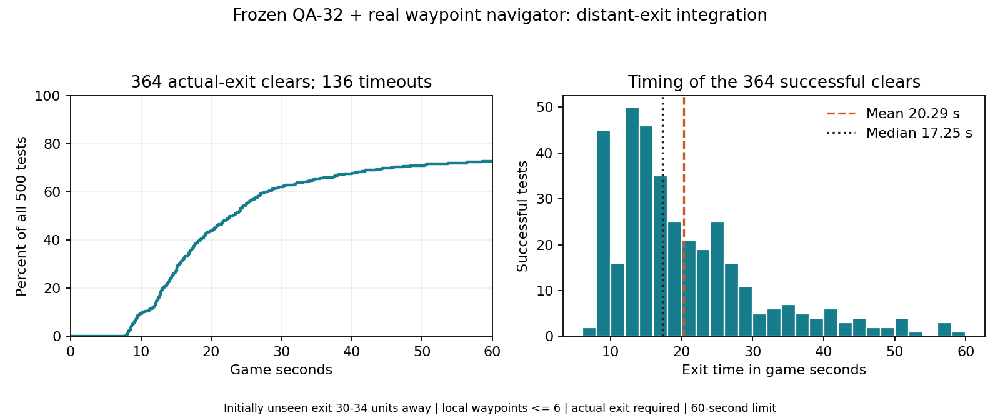

# QA-33: 500 frozen distant-exit integration tests

**364/500 actual-exit clears (72.8%), 136 timeouts, no deaths.** Used the saved QA-32 policy with the real observed-map waypoint navigator. Only the actual exit trigger counted as completion. No training or weight updates; the original checkpoint and its two snapshots remain saved unchanged. All sessions stopped.

| Successful clear time | Game seconds |
| --- | ---: |
| Mean | 20.29 |
| Median | 17.25 |
| 90th percentile | 35.29 |
| Fastest | 7.80 |
| Slowest | 58.60 |

Times describe the 364 successes only. All 136 failures reached the 60-second / 600-action limit. Of all 500 tests, 47 cleared by ten seconds, 220 by twenty, 311 by thirty, 350 by forty-five and 364 by sixty. Time is measured using the game controller's 0.1 seconds per action, not wall-clock processing time.

## Navigation and failure breakdown

The 40 x 40 room has boundary walls and no internal barriers or enemies. Seeded spawn/exit separation is **30-34 units** (observed 30.0144-33.9997); all 500 exits initially lay outside the **12-unit vision range**. The existing sensor map, frontier goal selector, observed-space A* planner and navigation coordinator run normally. The navigator supplies visible, actor-clear local waypoints within **six units**, not the distant exit's hidden coordinates. After discovery it can route toward the observed exit. The current recovery behavior can defer a repeatedly failed exit approach; this experiment did not modify that behavior.

- **364 clears:** all had discovered the exit in sensor memory.
- **101 timeouts:** exit was never discovered.
- **35 timeouts:** exit was discovered but the room was not completed.
- Waypoint assignments per attempt: **15.30 mean, 12 median, range 4-38**. These include reassignments/replans and are not a count of successful waypoint arrivals.
- Across 500 attempts: **1,963 replans** and **1,228 abandoned goals**.

Discovery reads persistent observed-map exit flags, not scene destination truth. Terminal navigation status is a final snapshot, not a trajectory; exit triggers can end an action before the next navigation refresh. In particular, a terminal `exploring` status does not prove the exit was never discovered. The aggregate breakdown distinguishes observed failures but does not isolate their cause.

## Frozen model and configuration

Evaluated the preserved [QA-32 8-12-unit skill checkpoint](../../qa-waypoint-reach-20261107-214655-train/README.md), SHA-256 `0ca5d55955bf6ea7489e2495c1a1cbd9c3be773154981483096dd17d4b4479e0`. Contract `local-waypoint-v1`, 134 inputs / two movement outputs. Deterministic PPO predictions, waypoint inputs enabled. Evaluation seeds **285000-285499**. Model training counter remains **63,246 steps / 7,000 lineage training episodes**. The **155,459 evaluation requests** are not training steps.

Episode deadline **60 game seconds**; the existing scene asset retains its 30-second value, overridden only in this run. The Editor records the applied deadline and Python asserts it. Playback scale is 100; historical configs retain default scale 20 and default deadline 30. The only source changes for this test pass these run-owned timing settings, record the actual deadline, accommodate it in episode checks and add observed-map exit-discovery telemetry. Navigator logic, observations, action mapping and model weights were not changed. No timeout termination/truncation correction was included; there are no optimizer updates in this evaluation.

Actual exit reward is **+50**, while all positive waypoint approach/arrival rewards share the **+5** per-attempt budget. Rewards are recorded but do not train the frozen model. Reconstructed positive waypoint totals respected +5 within floating-point recording tolerance (maximum approximately 5.000003). Exploration reward and stuck penalty totals were zero. Arrival at a waypoint itself never marks the room complete.

## Evidence and checks

- [500-test result](evaluation-result.json), [all episode records](episodes.jsonl), [analysis](analysis.json).
- [Actual config](training-config.yaml), [run/source hashes](run.json), [actual session settings](session.json), [readiness contract](policy-contract.json).
- [Separate reference verification](reference-verification.json), [its run/source provenance](reference-verification-run.json): all 500 configured starts unseen, eight compass exit completions, route/clearance/recovery/reward checks and **10/10 reference-controller clears**, with 157 handoffs and at least four before exit discovery per case. These reference attempts are excluded from the 500 learned-policy tests. Recording/deadline-reporting additions were compiled for the subsequent evaluation; navigation and policy sources are unchanged.
- [Test template](../../../../../Training/qa-player-waypoint-distant-exit-test.yaml), [runner](../../../../../Training/run_local_movement.py), [scenario guide](../../../../../Assets/Scenes/QaSingleRoomTraining.README.md#frozen-distant-exit-integration-test).

All 500 unique seeds, initial distances/visibility, action budgets, success/timeout counts and reward totals were checked. Evaluation made **zero optimizer updates**; all policy tensors, counters and checkpoint bytes remained unchanged. Source hashes matched, project settings restored and Unity exited successfully. Existing checkpoint/snapshot ZIPs passed hash, CRC and byte-count checks. Detailed local-only logs remain under `Logs/qa-waypoint-distant-exit-tests/20261107-220640-evaluate/` and the separate `20261107-220522-verify/` preflight.

This establishes combined navigator/policy performance in an open room with a distant exit. It does not establish reliable full-game QA, obstacle/combat behavior or generated-dungeon integration. No masked-waypoint control was run, so this result does not isolate the causal benefit of waypoint inputs. The earlier 99/100 skill result and historical 30-second exit tests use different tasks/conditions and are not matched before/after comparisons. No new checkpoint was trained or promoted.
