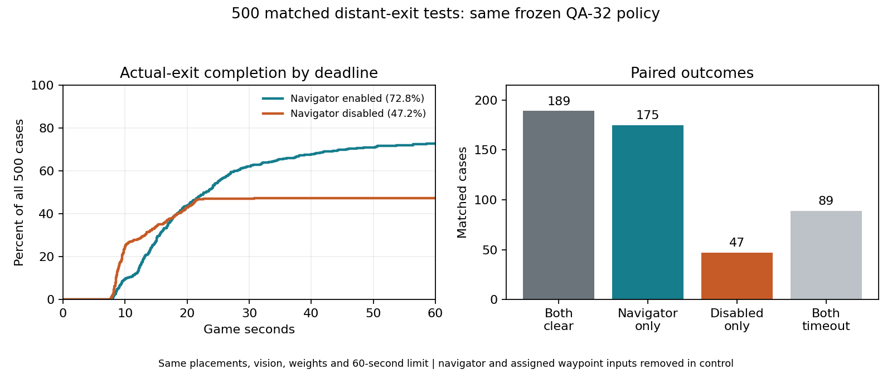

# QA-34: matched navigator-disabled comparison

**Navigator enabled completed more objectives: 364/500 clears (72.8%) versus 236/500 (47.2%) without it.** The navigator produced **128 additional clears / +25.6 percentage points** on identical seeds, spawn/exit positions and initial distances. No training or weight changes in either condition. All sessions stopped.

| Condition | Actual-exit clears | Timeouts | Mean episode time, including timeouts | Mean successful-clear time |
| --- | ---: | ---: | ---: | ---: |
| Navigator enabled, QA-33 | 364/500 (72.8%) | 136 | 31.09 s | 20.29 s |
| Navigator disabled, QA-34 | 236/500 (47.2%) | 264 | 37.52 s | 12.36 s |

All times are game seconds, 0.1 seconds per movement action. Failed attempts count as 60 seconds in the all-episode mean. Conditional successful-time means concern different subsets and do not by themselves establish a paired speed comparison. Among the **189 cases both cleared**, the disabled version was faster: **11.75 s versus 19.52 s**. Thus the navigator improves overall completion and capped average episode time, while adding time in cases this reactive policy already clears without it.

## Paired results

| Outcome | Cases |
| --- | ---: |
| Both clear | 189 |
| Only navigator-enabled clears | 175 |
| Only navigator-disabled clears | 47 |
| Both time out | 89 |

The enabled completion advantage is **+25.6 points**, paired case-bootstrap 95% interval **+20.2 to +31.0**, exact paired p **1.55e-18**. Bootstrap: 20,000 paired case resamples, RNG seed 285000. These are exploratory case-sampling comparisons, not variability across independent training runs. [Complete paired analysis](paired-comparison.json), [original navigator-enabled report](../distant-exit-20261107-220640-evaluate/README.md).

This compares the **same waypoint-trained frozen policy with its guidance removed**. It is not a comparison against a separately trained or optimized navigator-free policy. The input ablation may be outside the policy's usual training distribution; the result establishes the benefit of the existing guidance for this saved bot and task.

## What was disabled and preserved

The evaluation-only `navigator_disabled` flag bypasses goal selection, routing and recovery in `QaSingleRoomRlEnvironment`. Navigation resets to no assignment and never advances. Policy features **130-133 remain zero on every step**; no direct-exit summary replaces them. Every episode recorded **zero waypoint assignments, replans, abandoned goals and waypoint arrival bonus**. This physically disables the navigator rather than merely masking its output in Python. The historical `--without-waypoint` flag is a different, input-only control and was not used here.

Unchanged: frozen [QA-32 checkpoint](../../qa-waypoint-reach-20261107-214655-train/README.md), SHA-256 `0ca5d55955bf6ea7489e2495c1a1cbd9c3be773154981483096dd17d4b4479e0`; current wall/exit ray channels, previous movement, actions, real exit trigger and rewards, 40 x 40 room, 30-34-unit unseen exit, 12-unit vision, 60-second / 600-action limit and seeds **285000-285499**. All 500 initial placements exactly match QA-33. The same source remains active for sensing, mapping, policy encoding and player movement; source additions implement and verify the default-off evaluation switch plus record its state. Baseline-on behavior is unchanged when the switch is false.

Sensor memory is still collected for diagnostics but does not select goals or enter the policy observation. Actual exit reward +50 and time/stuck costs remain; waypoint reward is zero without assignments. Rewards do not update the frozen policy. Model training counter remains **63,246 steps / 7,000 lineage episodes**; **187,581 evaluation requests** are not training steps.

## Disabled-condition timing and discovery

Successful-only times: mean **12.36 s**, median **9.90 s**, p90 **19.80 s**, range **7.50-30.80 s**. All 264 failures timed out at 60 seconds; no deaths. All 236 clears had discovered the exit. Of the failures, **179 never discovered it**, while **85 discovered it but did not complete**. The enabled condition had 101 undiscovered-exit timeouts and 35 discovered-exit timeouts. This is a descriptive breakdown, not an isolated explanation of individual failures.

## Evidence and verification

- [Actual config](training-config.yaml), [run/source hashes](run.json), [session](session.json), [readiness contract](policy-contract.json).
- [500-test disabled result](evaluation-result.json), [all disabled episode records](episodes.jsonl), [paired comparison](paired-comparison.json), [original enabled records](../distant-exit-20261107-220640-evaluate/episodes.jsonl).
- [Disabled-control preflight](verification.json), [its run provenance](verification-run.json): 500 matched seeded resets with no waypoint inputs/assignments, 600-action idle timeout, retained exit rays and eight ray-guided actual-exit compass clears. Reference episodes are excluded from the 500 policy cases.
- [Control template](../../../../../Training/qa-player-waypoint-distant-exit-no-navigator.yaml), [runner](../../../../../Training/run_local_movement.py), [guide](../../../../../Assets/Scenes/QaSingleRoomTraining.README.md#frozen-distant-exit-integration-test). Detailed local-only logs: `Logs/qa-waypoint-distant-exit-no-navigator/20261107-230050-evaluate/` and separate `20261107-225939-verify/` preflight.

Verified all 500 unique seeds, exact initial-state matches, timeouts, absence of waypoint features/counters/rewards, unchanged current-source hashes and preserved checkpoint. Policy tensors, counters and model bytes stayed unchanged; optimizer updates **zero**. Project settings restored and Unity exited successfully. No model promotion, retraining or additional stage.
