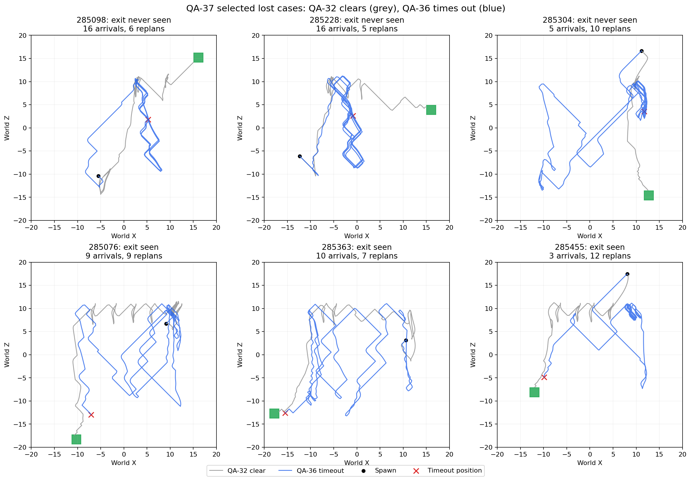

# QA-37: localizing QA-36 exit-navigation failures

**The main failure stage is reaching/discovering the exit, and the six selected replays expose a local steering problem: repeated loops and movement away from assigned waypoints.** This is stronger evidence than a terminal navigation-status label. It does not establish that all 168 failures have the same cause or that a particular input change fixes the behaviour.

## Full 500-case evidence

| Outcome | QA-32 | QA-36 |
| --- | ---: | ---: |
| Clears | 364 | 332 |
| Timed out without ever discovering the exit | 101 | 116 |
| Discovered exit but timed out | 35 | 52 |

Of the **90 newly lost cases** that QA-32 cleared and QA-36 failed, **68 never discovered the exit** and **22 discovered it but did not finish**. The 58 gained cases came from 53 previously undiscovered-exit timeouts and five previously discovered-exit timeouts. Net loss is 32 clears. Differences in discovery and completion are measured stages, not isolated causes: locomotion controls what the sensors can discover.

Directional breakdown uses the true initial spawn-to-exit bearing only for analysis, not as a policy input:

| Exit bearing | Cases | QA-32 clears | QA-36 clears | Change |
| --- | ---: | ---: | ---: | ---: |
| N | 61 | 42 | 41 | -1 |
| NE | 63 | 54 | 54 | +0 |
| E | 64 | 45 | 49 | +4 |
| SE | 62 | 46 | 51 | +5 |
| S | 61 | 58 | 47 | -11 |
| SW | 64 | 48 | 33 | -15 |
| W | 63 | 38 | 23 | -15 |
| NW | 62 | 33 | 34 | +1 |

South/southwest/west account for **41 fewer clears**, partly offset by nine additional clears in the other bearings. This localizes a directional weakness in the integrated task, not a controlled test of one movement direction.

## Six exact frozen replays

Selected three newly lost undiscovered-exit failures and three newly lost discovered-exit failures, including near-exit cases. This purposive sample is not a prevalence estimate. Each replay exactly matches the original outcome, 600 action count and final exit distance; all zero training/optimizer updates, unchanged checkpoint hashes/counters. All 600 actions in every replay have an assigned waypoint. Existing read-only telemetry was extended to retain all 134 policy inputs for these cases.



Grey: QA-32's earlier frozen trace, which clears. Blue: QA-36's matched replay, which times out. Black dot: spawn. Red cross: timeout position. Green box: actual exit trigger. Both models already show some imperfect paths; the child adds repeated circuits or local loops that consume the deadline.

| Seed | Exit first seen | Commands away/perpendicular to waypoint | Waypoint arrivals | Replans | Nearest exit centre |
| --- | ---: | ---: | ---: | ---: | ---: |
| 285098 | Never | 293/600 | 16 | 6 | 13.43 units |
| 285228 | Never | 286/600 | 16 | 5 | 15.62 units |
| 285304 | Never | 315/600 | 5 | 10 | 13.25 units |
| 285076 | 57.6 s | 359/600 | 9 | 9 | 6.24 units |
| 285363 | 32.9 s | 356/600 | 10 | 7 | 2.36 units |
| 285455 | 57.5 s | 327/600 | 3 | 12 | 3.90 units |

The six paths cover about **236-240 units each in 60 game seconds**, with net displacements only **13-30 units**. This is movement with repeated detours/loops, not a simple absence of movement. There are 25-32 waypoint assignments per attempt, but only 3-16 recorded arrivals. Assignment counts include replacements and are not arrival counts.

The command-direction metric is the cosine between the actual two-output movement command and the actor-to-assigned-waypoint direction. Nonpositive values include away, perpendicular and any zero command; this does not imply an explicit semantic choice to reject an exit. Distances are to exit centre, not trigger-overlap tests.

**Near-exit cases:** 285076 and 285455 first see the exit at 57.6 and 57.5 seconds respectively, leaving 2.4/2.5 seconds before the deadline. Case 285363 first sees it at 32.9 seconds. Its exit-directed waypoint at action 330 starts 5.87 units away; after 22 actions it is 11.60 units away. A replacement at action 352 starts 5.66 units away and ends 11.04 units away after 20 actions. At action 372 navigation switches to exploration, consistent with the coordinator's repeated-failure recovery rule. This identifies poor local approach followed by recovery/goal switching; terminal `exploring` alone would not establish that sequence. The trace does not isolate every later goal-selection decision.

**None of these six cases was assigned or reached the final exit-route waypoint.** Their failures occur earlier than entering the exit after final-waypoint arrival. They do not test the final-arrival success rate across all 500 QA-36 cases.

## Same-state policy comparison and previous-action sensitivity

Feed the exact recorded child observations to both frozen models. Reproduced child commands agree with the traced commands to within 0.000001. QA-32's commands are more aligned with the waypoint on all six recorded state sets:

| Seed | QA-36 mean alignment | QA-32 on same states | QA-36 with previous-action inputs zeroed |
| --- | ---: | ---: | ---: |
| 285098 | 0.004 | 0.354 | 0.745 |
| 285228 | 0.067 | 0.334 | 0.696 |
| 285304 | -0.010 | 0.376 | 0.371 |
| 285076 | -0.119 | 0.218 | 0.568 |
| 285363 | -0.141 | 0.249 | 0.500 |
| 285455 | 0.000 | 0.335 | 0.332 |

Alignment +1 means directly toward the waypoint, 0 perpendicular and -1 directly away. This is a per-action arithmetic mean, not a rollout success rate. Parent predictions on child states are not counterfactual world rollouts.

Zeroing only previous movement features 0-1 also raises mean alignment on all six state sets. That demonstrates sensitivity of the output to movement history and makes previous-action feedback a strong candidate for a controlled ablation. It does **not** validate removing the input: future states would change, modified observations can be outside the training distribution, and no closed-loop zero-history rollout was run. We have localized a steering/feedback problem, not proven its training cause or a production fix.

## Interpretation and next diagnostic

Investigate local waypoint tracking and the previous-action feedback before changing exit-reward magnitude. A focused next experiment would compare frozen normal and zero/reset-history rollouts on matched cases while tracking waypoint progress and exit discovery, then retain the parent as a regression baseline. This is a proposed diagnostic only; no input masking, retraining, navigation fix, promotion or later stage was applied here. Navigation recovery deserves separate inspection where local failures cause exit pursuit to be deferred, but these six cases do not justify attributing every failure to the navigator.

## Evidence and reproduction

[Full 500-case transition/bearing analysis](full-benchmark-analysis.json), [all six trace summaries and assignment segments](trace-analysis.json), [analysis script](analyze.py), [replay launcher](run_selected_cases.py). Each `trace-<seed>/` folder retains original per-episode/run/config/result records and compressed JSONL actions. `case-<seed>.yaml` identifies exact frozen checkpoint, seed and task. Local-only runtime logs live under `Logs/qa36-failure-analysis/case-<seed>/`.

From the game directory, analysis of the already completed traces can be reproduced with:

```powershell
python -B SavedModels/qa/local-waypoint-v1/diagnostics/qa36-failure-analysis-20261108/analyze.py
```

The six-case launcher is provenance for completed evaluations, not a background job. All sessions are stopped. The standalone static eight-direction output probe was exploratory only and was not used to claim rollout performance.
