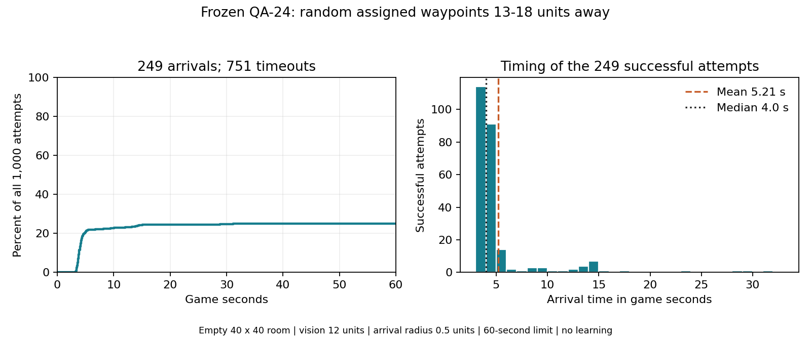

# QA-26: 1,000 random distant-waypoint attempts

**249/1,000 arrivals (24.9%); 751 timeouts at 60 game seconds.** All sessions stopped. No training, model promotion or curriculum advancement.

| Successful arrival time | Game seconds |
| --- | ---: |
| Mean | 5.21 |
| Median | 4.00 |
| 90th percentile | 8.36 |
| Fastest | 3.20 |
| Slowest | 31.20 |

Timing statistics describe the 249 successes only. Of all 1,000 attempts, 208 arrived by five seconds, 228 by ten seconds, 248 by thirty seconds and 249 by sixty seconds. Game time uses the existing controller's 0.1 seconds per movement action; it is not wall-clock processing time. The full run took about 15.6 wall-clock minutes, including startup.

## Task and checkpoint

- Frozen deterministic [QA-24 checkpoint](../../qa-waypoint-20261104-170721-train/README.md), `local-waypoint-v1`, 134 inputs and two movement outputs. SHA-256 `78548d2ca50e90f61b737e9f74a6bf983c7682ea96c2e431b94cf71810076c36`.
- Empty 40 x 40 room with boundary walls. Fixed centre spawn, random target angle uniform in [0, 2pi) and radius uniform in [13, 18) units, sampled using `System.Random` separately for seeds 270000-270999. Observed distances 13.0019-17.9926 units; every initial target was beyond the 12-unit vision range.
- One fixed waypoint per attempt; 0.5-unit horizontal arrival radius; maximum 600 actions / 60 game seconds. Reset restores player state and clears perception. The same real player controller, wall sensors, action mapping and waypoint feature encoding are used throughout.
- Exit object/trigger disabled; marker has no collider or sensor label. Exit observation channels were checked as zero on every policy input. Automatic waypoint selection and recovery are bypassed.
- The assigned waypoint presence and direction remain available beyond vision, and distance remains clipped to `clamp01(distance / 12)`. This is reaching a supplied distant target, not searching for an unknown target. It also exceeds the normal navigator's six-unit waypoint range, so it does not measure performance on the normal nearby-waypoint contract in isolation.

## Additional measured breakdown

Directions use world X/Z axes (east = +X, north = +Z), not the player's facing.

| Target quadrant | Arrivals / attempts |
| --- | ---: |
| Northeast | 65/249 |
| Northwest | 6/251 |
| Southeast | 104/250 |
| Southwest | 74/250 |

Results vary strongly by direction on this sample. This does not identify the cause. Seventy-seven of the 751 failures came within one unit at some point, but never within the required 0.5 units at an action boundary. There is no masked-input control in this evaluation, so causal dependence on the waypoint signal is not established.

## Verification and evidence

All 1,000 seeds are unique and exactly match the requested range; every episode's action count, duration and arrival/timeout result were cross-checked. Zero new optimizer updates; policy tensors, model training-step counter and checkpoint bytes unchanged. All recorded source hashes matched after execution, Unity exited successfully and project settings were restored.

The initial 20x-playback segment was intentionally halted for faster playback after 21 Unity-recorded completed cases (3 arrivals, 18 timeouts; Python had acknowledged 20 before disconnect). The final run restarted the full seed range at 100x playback. All 21 repeated cases matched outcomes and action counts exactly. Those earlier cases are excluded from the 1,000-case denominator. The resulting planned-disconnect error belongs only to the halted timing segment; the final run completed normally.

- [Run configuration and source hashes](run.json), [final summary](result.json), [all 1,000 episode records](episodes.jsonl), [analysis](analysis.json), [playback comparison](playback-comparison.json).
- [Runner](../../../../../Training/test_waypoint_reach_batch.py), [Unity diagnostic](../../../../../Assets/Editor/QaWaypointReachBatchSession.cs). Rerun from the game root with `python Training/test_waypoint_reach_batch.py`.
- Detailed Unity logs are local-only under `Logs/qa-waypoint-reach/20261106-212716-1000/`; the halted timing segment remains under `Logs/qa-waypoint-reach/20261106-212511-1000/`.
